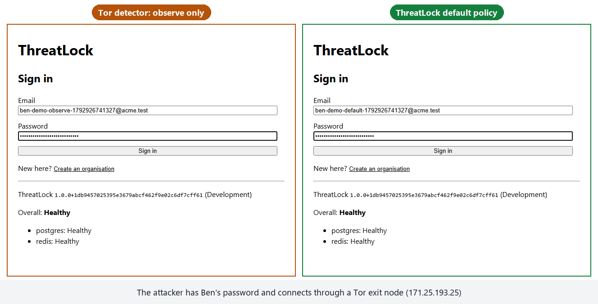
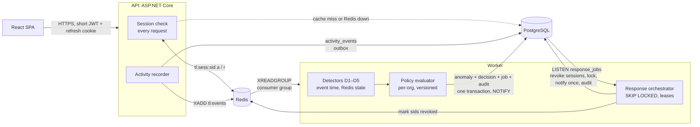

# ThreatLock

**Automatic response to stolen sessions: detects account takeover from the activity stream, decides with each organisation's own policy, and revokes the attacker's sessions within about 200 ms.**

[](https://github.com/Kar6677thik/ThreatLock/actions/workflows/ci.yml)


-DC382D)


A multi-tenant notes app with real logins, and the security pipeline behind it. It's a learning-scale rebuild of Slack's
[Anomaly Event Response](https://slack.engineering/building-slacks-anomaly-event-response/). Every request becomes an activity event.
Five detectors look for account takeover (Tor exits, impossible travel, scraping, a new device that exports everything, a session that
changes machines). Each organisation's versioned policy decides what to do, and a background worker carries it out: it revokes every
session of the user (optionally locking the account), notifies each admin exactly once, and writes a tamper-evident audit entry.

The design targets the two ways this kind of system fails: **the response is too slow or gets lost** (an attacker with a stolen token
keeps working for an hour), or **it fires on the wrong people** (signing out a whole office that happens to use a VPN).

## One stolen password, two policies

The same password, used through the same Tor exit, against two organisations. On the left the Tor detector only observes; on the right
is ThreatLock's default policy.

<p align="center">
  
</p>

| Same attacker, same data | Observe only | ThreatLock default |
|---|---:|---:|
| Tor login detected | yes | yes |
| Attacker's session revoked | never | **94 ms** after sign-in |
| Attacker's next click | reads the payroll note, exports everything | **"You were signed out"** |
| Admins notified | no | once each |
| Audit chain | intact | intact, with the response recorded |

*Recorded from the real stack (API, Worker, PostgreSQL, Redis, the SPA) with Playwright, against the live Tor exit list. Commands to
reproduce are [below](#record-the-demo).*

## Measured results

Every number comes from a scripted, reproducible experiment, run first against a deliberately naive version and then against the fix.
Reports include the commands, the machine, the raw output and the threats to validity ([method](docs/experiments/README.md)).

| Failure mode | Naive | ThreatLock | Mechanism |
|---|---|---|---|
| **Revoked token keeps working** ([B1](docs/experiments/B1-stateless-jwt.md)) | 149.5 s with 2-min tokens; ~1 hour with 60-min ones | **rejected on the next request**, +0.6 ms per request | short JWT + server-side session check, Redis cache, PostgreSQL fallback |
| **Stolen token replayed from another country** ([B2](docs/experiments/B2-cookie-replay.md)) | still working after 15 s, 10/10 trials | **revoked, 10/10** | D5 session fingerprint (device + browser family) |
| **VPN users flagged as impossible travel** ([B3](docs/experiments/B3-vpn-false-positive.md)) | 499 of 500 signed out | **0 of 500**, attacks still caught 100/100 | per-org trusted networks, "every IP trusted" rule |
| **Responder crashes mid-job**, 100 times ([B4](docs/experiments/B4-idempotent-responder.md)) | 532 notifications for 300; 34 revoked sessions still cached as active | **300 / 300, 0 stale** | job table with leases, step markers committed with each effect |
| **Superuser edits an audit entry** ([B5](docs/experiments/B5-audit-tamper.md)) | invisible: the row looks normal | **named: seq 3, hash mismatch**; truncation caught with an anchor | per-org SHA-256 chain, append-only trigger |
| **Accuracy** on 1,200 labelled scenarios ([eval](docs/experiments/Eval-detection-and-time-to-revoke.md)) | first run: 28.2 % of benign users signed out | **14.3 %**; 0.1 % excluding the expected migration export; **recall 100 %** | replay harness, D3 cold-start rule |
| **Time to revoke**, 200 live attacks each ([eval](docs/experiments/Eval-detection-and-time-to-revoke.md)) | — | **p95 199 ms** (Tor login), **142 ms** (replayed token) | Redis Streams, LISTEN/NOTIFY, Redis revocation marker |

Measured locally (Intel Core Ultra 5, Docker Desktop). The re-run on the home server is part of deployment (M10).

## Architecture



There are two queues on purpose ([ADR-0003](docs/adr/0003-event-transport-redis-streams-and-postgres-jobs.md)):

- **Activity events** are high volume and tolerate a lost one. They go through a Redis Stream, with the PostgreSQL table as an outbox.
- **Response jobs** must never be lost, so they live in PostgreSQL, in the same transaction as the anomaly that caused them.

The full behaviour, including edge cases, is in the [specification](docs/spec/SPEC.md), and every major choice has an
[architecture decision record](docs/adr/README.md).

## How it works

**Sessions that can actually be revoked.** An access token lives 5 minutes and carries a session id. The API checks that session on
every request: Redis first (`a` or `r`), PostgreSQL on a miss or outage, and **503 if neither answers** (fail closed). Revocation writes
`r` rather than deleting the key, so a revoked session can't be served a stale "active". Refresh tokens rotate, and a reused one kills
the session ([ADR-0002](docs/adr/0002-short-lived-jwt-plus-server-side-session-check.md)).

**Events that aren't lost.** Each request's event is written to `activity_events`, then `XADD`ed to a stream. A sweeper republishes
anything the stream missed. The Worker's consumer group acknowledges only after processing, reclaims messages from dead consumers,
and dead-letters poison ones.

**Five detectors on event time, never the wall clock**, so a replay of two weeks takes seconds:

| Detector | Fires on | Severity |
|---|---|---|
| D1 Tor exit | an authenticated event from the live Tor exit list | High |
| D2 Impossible travel | two locations too far apart for the time between them (haversine, GeoIP accuracy subtracted) | Medium |
| D3 Scraping | reads per minute above `max(60, μ + 4σ)` of the user's own EWMA baseline | Medium, High at 3× |
| D4 New device + export | an export or 50+ distinct notes within 30 min of a login from a device new to this user | High |
| D5 Session hijack | refresh-token reuse, or a session whose device or browser family changes | Critical / High |

**Policy is data.** Each org edits a versioned policy: mode per detector (off, observe, notify, respond), minimum severity, thresholds,
trusted networks, excluded users and roles, and lock-on-severity. Six rules apply in a fixed order, so every anomaly records exactly
one reason and the policy version that judged it. Saves use optimistic concurrency, so two admins can't silently overwrite each other.

**A response that is safe to run twice.** The anomaly, its decision, its response job and its audit entry commit together. Workers
claim jobs with `FOR UPDATE SKIP LOCKED` and a 60 s lease, and LISTEN/NOTIFY starts a job within milliseconds. Every step either is
naturally idempotent or commits a marker together with its effect. Notifications go to distinct people, are grouped per user for an
hour, and are backed by a unique constraint. The last owner of an org is never locked out.

**Evidence that can't be quietly edited.** Each org's audit log is a SHA-256 hash chain over a length-prefixed canonical form, with JSON
keys sorted and timestamps at the database's precision. Appends take an advisory lock per org. A trigger refuses UPDATE, DELETE and
TRUNCATE for every role. `verify` names the first broken entry, and a saved anchor also catches a full rewrite. The Simulator can
re-verify a chain independently of the server.

**Measured, not assumed.** A seeded dataset generator, a replay harness and a live HTTP harness produce the numbers above. A small
replay runs in CI, so losing an attack kind or starting to sign out benign users fails the build. The API and Worker export Prometheus
metrics.

## Quick start

Requires Docker, the .NET 10 SDK and Node 24.

```bash
docker compose -f deploy/compose/docker-compose.yml up -d --wait   # PostgreSQL + Redis
scripts/download-geoip.sh                                          # DB-IP Lite city database (optional: without it, D2 never fires)
dotnet run --project src/ThreatLock.Api                            # http://127.0.0.1:5080, migrates on start
dotnet run --project src/ThreatLock.Worker                         # downloads the live Tor exit list
cd web && npm install && npm run dev                               # http://localhost:5173
```

| URL | What |
|---|---|
| http://localhost:5173 | The app: create an organisation, add users, write notes. Admins see Anomalies, Users, Policy, Jobs, Audit log and Notifications |
| http://127.0.0.1:5080/readyz | Readiness: PostgreSQL and Redis |
| http://127.0.0.1:5080/metrics | API metrics (Prometheus) |
| http://localhost:9464/metrics | Worker metrics: anomalies, response jobs, stream lag, time to revoke |

In development, requests with the simulator key can choose their client IP (`X-Simulated-Client-Ip`), which is how the demos come
"from" Tor or another country ([ADR-0007](docs/adr/0007-client-ip-resolution-and-simulation-header.md)). That switch must stay off
anywhere reachable from the internet.

### Record the demo

With the stack above running:

```bash
cd web && npx playwright install chromium
node demo/record-demo.mjs                          # two orgs, two attackers, two admins → artifacts/demo/
cd .. && python scripts/demo/make-gif.py           # → docs/assets/stolen-session-demo.gif (needs Pillow)
```

### Run the experiments and tests

```bash
dotnet run --project src/ThreatLock.Simulator -c Release -- replay --seed 42                 # FP rate, recall, precision (~15 s)
dotnet run --project src/ThreatLock.Simulator -c Release -- live --base-url http://127.0.0.1:5080 \
    --sim-key dev-only-simulator-key-change-me --kind tor --attacks 200                      # time to revoke
scripts/experiments/b4-responder-crashes.sh                                                   # naive vs idempotent responder
scripts/experiments/b5-audit-tamper.sh                                                        # superuser tampering vs the chain

dotnet test                     # 284: 122 unit, 8 evaluation, 154 integration (Testcontainers, real PostgreSQL + Redis)
cd web && npm test              # 27 component and client tests
cd web && npm run e2e           # Playwright: sign up → stolen password via Tor → "You were signed out"
```

The naive versions are kept: the responder at the git tag `break/b4-naive-responder`, stateless JWTs behind `Auth:Mode=StatelessJwt`,
and the others as policy settings. Every experiment can be re-run on demand.

## Deployment

Planned, not yet live. The target is single-node **k3s** on a home server, deployed only from GitHub Actions
([ADR-0008](docs/adr/0008-deployment-k3s-github-actions-tailscale.md)):

- **Build:** SHA-tagged images (the API image includes the SPA) are pushed to GHCR.
- **Access:** the runner joins a private tailnet as an ephemeral tagged node and runs a root-owned helper allowed by a narrow sudoers rule.
- **Apply:** a migration Job first, then Deployments pinned to image digests.
- **Exposure:** tailnet only. No part of a deliberately attackable lab app is on the public internet, and `/metrics` is never routed by the ingress.

## Repository layout

```
src/
  ThreatLock.Core/            pure logic: detectors, policy evaluator, response planning, audit chain, EWMA (no I/O)
  ThreatLock.Infrastructure/  PostgreSQL (EF Core + Npgsql), Redis, session store, event publisher, job queue, audit log, metrics
  ThreatLock.Api/             ASP.NET Core minimal APIs: auth, notes, admin, policy, audit; session check middleware
  ThreatLock.Worker/          stream consumer, detectors, response orchestrator, Tor list, baselines, retention
  ThreatLock.Simulator/       dataset generator, replay harness, live harness, independent audit verifier
web/                          React + Vite + TypeScript SPA, Vitest, Playwright e2e and the demo recorder
tests/                        unit, evaluation and Testcontainers integration tests
scripts/                      experiments (B1–B5), GeoIP download, demo GIF
deploy/compose/               local PostgreSQL and Redis
docs/                         specification, ADRs, experiments, learning journal, concepts
```

## Stack

C# / .NET 10 · ASP.NET Core minimal APIs and Identity · EF Core 10 with Npgsql · PostgreSQL 17 · Redis 8 (Streams and cache) ·
React 19, Vite, TypeScript · OpenTelemetry and Prometheus · xUnit v3 and Testcontainers · Vitest and Playwright · GitHub Actions.

## Documentation

| | |
|---|---|
| [Specification](docs/spec/SPEC.md) | problem, architecture, sessions, events, detectors, policy, response, audit, evaluation, milestones |
| [Decision records](docs/adr/README.md) | 9 ADRs: what was decided, the alternatives and the trade-offs |
| [Experiments](docs/experiments/README.md) | B1–B5 and the evaluation, each failure measured before and after the fix |
| [Build journal](docs/learning/journal/README.md) | M0–M9: what was done, why, what broke, and the numbers |
| [Concepts](docs/learning/concepts.md) | the ideas behind it, from refresh-token rotation to canonical serialisation |
| [Development guide](docs/development.md) | setup, configuration, the Simulator, troubleshooting |

## Data sources and inspiration

- IP geolocation by [DB-IP](https://db-ip.com) (DB-IP Lite, CC BY 4.0); Tor exit list from the [Tor Project](https://check.torproject.org/torbulkexitlist).
- Slack Engineering, [Building Slack's Anomaly Event Response](https://slack.engineering/building-slacks-anomaly-event-response/); InfoQ, [Slack's AER security system](https://www.infoq.com/news/2025/10/slack-aer-security-system).

All attacks in this repository are run only against our own app.
