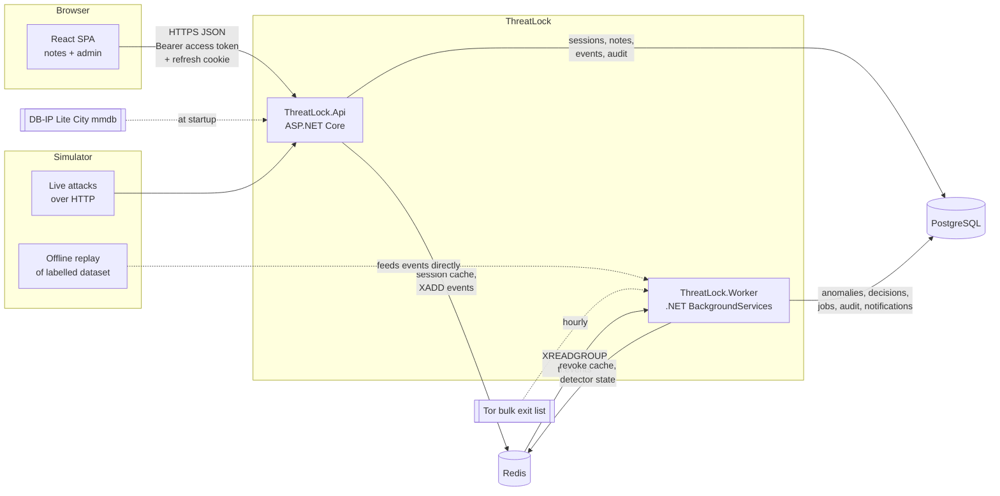
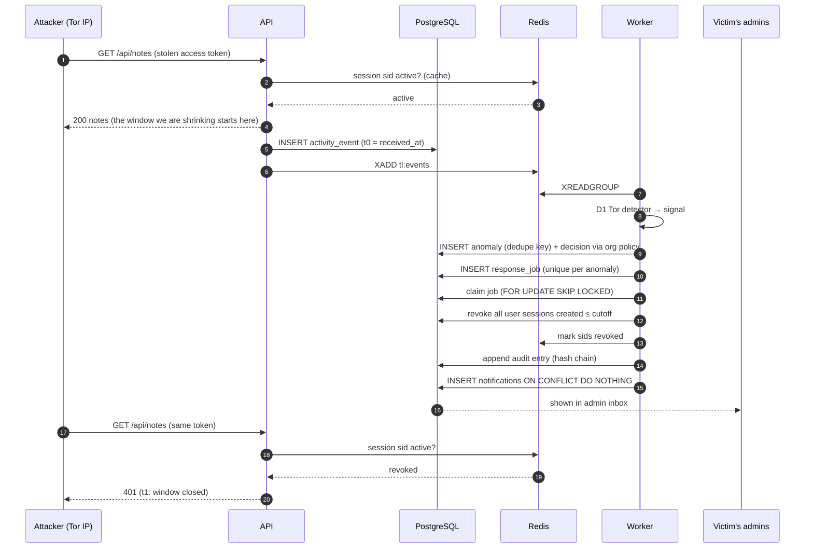
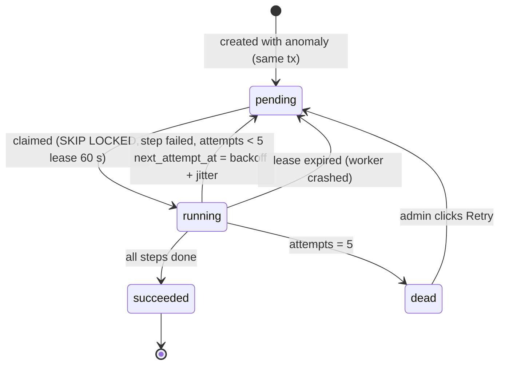
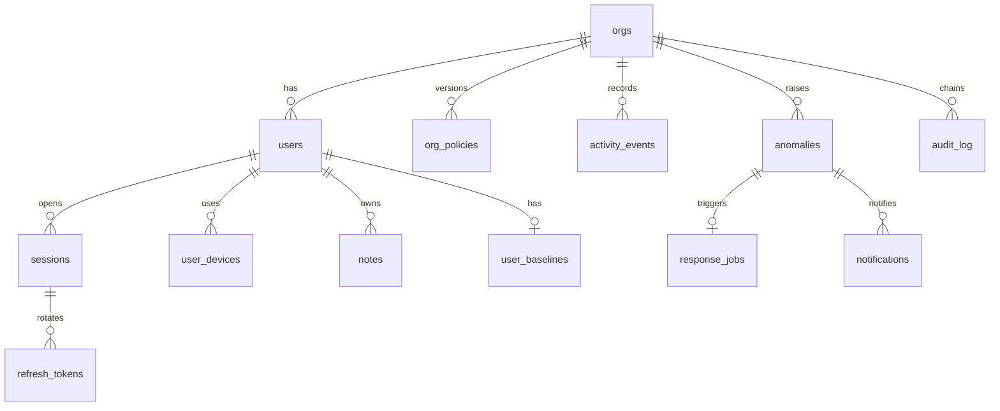

# ThreatLock specification

| | |
| --- | --- |
| Status | Draft for M0 (specification pass) |
| Owner | Karthik Reddy Surkanti |
| Source problem | Project 4, "Security anomaly detection and automatic response (Slack)", from *10 Engineering Projects from Real Company Problems* |
| Field Guide sections | 8 Identity, 9 Data modelling, 18 Messaging, 19 Workflows, 23 Testing, 24 Observability, 25 Security, 33 Decision records, 34–35 Anti-patterns |

This document says **what** ThreatLock does and the **rules** it follows. The reasons behind the big choices live in the [decision records](../adr/README.md); the theory lives in [concepts.md](../learning/concepts.md). When this spec and the code disagree, one of them is a bug: fix whichever is wrong and note it in the milestone journal.

Words like **must**, **should** and **may** are used deliberately: *must* is tested, *should* is the default unless a journal entry explains otherwise, *may* is optional or a stretch goal.

---

## Contents

1. [Problem and goals](#1-problem-and-goals)
2. [Scope](#2-scope)
3. [Glossary](#3-glossary)
4. [Tenancy, users and roles](#4-tenancy-users-and-roles)
5. [Architecture](#5-architecture)
6. [Identity, sessions and revocation](#6-identity-sessions-and-revocation)
7. [Activity events and transport](#7-activity-events-and-transport)
8. [Detection engine](#8-detection-engine)
9. [Decision framework](#9-decision-framework)
10. [Response orchestrator](#10-response-orchestrator)
11. [Tamper-evident audit log](#11-tamper-evident-audit-log)
12. [Data model](#12-data-model)
13. [API surface](#13-api-surface)
14. [User interface](#14-user-interface)
15. [Break and Prove experiments](#15-break-and-prove-experiments)
16. [Evaluation and metrics](#16-evaluation-and-metrics)
17. [Testing strategy](#17-testing-strategy)
18. [Observability](#18-observability)
19. [Securing ThreatLock itself](#19-securing-threatlock-itself)
20. [Local development and deployment](#20-local-development-and-deployment)
21. [Milestones](#21-milestones)
22. [Resolved confusions](#22-resolved-confusions)
23. [Open questions](#23-open-questions)
24. [Definition of done](#24-definition-of-done)

---

## 1. Problem and goals

### 1.1 The real problem

A stolen session (a copied cookie, a leaked token, a password typed into a phishing page) is only dangerous for as long as it stays valid. If detection raises an alert that a human reads hours later, the attacker has had hours. Slack's Anomaly Event Response (AER) closes that gap by making the *response* automatic.

Slack's AER has three parts, and ThreatLock copies the shape exactly:

| Slack AER part | What it does | ThreatLock component |
| --- | --- | --- |
| Detection engine | Spots anomalies such as Tor exit-node access or data scraping | **Detectors** in the Worker ([§8](#8-detection-engine)) |
| Decision framework | Applies each organisation's settings, exclusions and baselines | **Policy evaluator** in the Worker ([§9](#9-decision-framework)) |
| Response orchestrator | Async job signs the user out everywhere, writes an audit entry naming the anomaly, notifies admins without duplicates | **Response jobs** in the Worker ([§10](#10-response-orchestrator)) + **audit log** ([§11](#11-tamper-evident-audit-log)) |

### 1.2 Goals

| ID | Goal | How we will know |
| --- | --- | --- |
| G1 | A revoked session stops working almost immediately | Client-observed time from malicious request to first `401`, **p95 ≤ 5 s** on the home server (target, to be measured) |
| G2 | Each organisation controls what triggers an automatic response | Per-org policy with modes, thresholds, exclusions; covered by tests |
| G3 | Responses are safe to run twice | Re-running any response job produces zero extra revocations, audit entries or notifications; covered by tests |
| G4 | The audit log is tamper-evident | Editing or deleting any row is detected by `verify`, which names the first broken entry |
| G5 | False positives are measured, not guessed | Labelled synthetic dataset; report false-positive rate per detector and overall |
| G6 | Everything is learnable | Every milestone has a journal entry (what, why, when, commands, results) |

The numbers in G1 and G5 are targets. Only measured values go into the final report and the résumé line.

---

## 2. Scope

### 2.1 In scope

- A multi-tenant notes app: organisations, users, roles, private and shared notes, bulk export.
- Real logins with ASP.NET Core Identity (password hashing, lockout).
- Server-side sessions in PostgreSQL, short-lived access tokens, rotating refresh tokens.
- Activity events for every authenticated action, flowing through Redis Streams to a background Worker.
- Five detectors (D1–D5), per-org policy, automatic response, admin notifications, hash-chained audit log.
- A React admin UI: anomalies, policies, sessions, audit log, notifications, failed jobs.
- A Simulator: live attack scenarios over HTTP, and an offline replay harness for the labelled dataset.
- Break and Prove experiments with written reports.
- CI on every pull request; CD to k3s on the home server through GitHub Actions.

### 2.2 Out of scope (non-goals)

| Not doing | Why |
| --- | --- |
| MFA, password reset by email, SSO/OIDC login | Valuable but orthogonal to detection and response. Noted as stretch goals. |
| Machine-learning models | Rules plus per-user statistical baselines teach the core ideas; ML adds noise at this scale. |
| Users belonging to several organisations | Slack supports it; we keep one org per user so tenancy stays simple. |
| Blocking requests inline before they reach the app | ThreatLock is *detect then respond* (async), like AER. See [ADR-0004](../adr/0004-asynchronous-detect-then-respond.md). |
| High availability, multiple replicas, managed databases | One home server. We design so scaling is possible, but don't do it. |
| Real email or SMS delivery | In-app notifications only; an optional webhook is a stretch goal. |
| Public internet exposure | Tailnet only. See [ADR-0008](../adr/0008-deployment-k3s-github-actions-tailscale.md). |

---

## 3. Glossary

| Term | Meaning in ThreatLock |
| --- | --- |
| **Org** (organisation, tenant) | A customer workspace. All data belongs to exactly one org. |
| **Session** | A server-side row created at login. It is the thing we revoke. Identified by `sid`. |
| **Access token** | A short-lived signed JWT (5 min) the browser sends on every API call. Carries `sid`. |
| **Refresh token** | A long random secret in an HttpOnly cookie, used only to get a new access token. Rotated on every use. |
| **Device** | A random `deviceId` the browser generates once and keeps in `localStorage`. Not a security boundary, a signal. |
| **Activity event** | A record of something a user did (login, read note, export). High volume, short retention. |
| **Detector** | Code that looks at activity events and emits a *signal* when something looks wrong. |
| **Anomaly** | A persisted, de-duplicated signal with evidence. One anomaly → at most one decision → at most one response. |
| **Policy** | Per-org settings that turn an anomaly into a decision. |
| **Decision** | The outcome for one anomaly: `suppressed`, `observed`, `notified`, or `responded`. |
| **Response job** | The durable unit of work that revokes sessions, audits and notifies for one anomaly. |
| **Audit log** | Append-only, hash-chained record of security-relevant actions. Low volume, long retention. |
| **Time to revoke** | Time from the malicious request reaching the API to the first request with that session being rejected. See [§16.2](#162-time-to-revoke). |
| **False positive** | A benign scenario that our system responded to. See [§16.1](#161-false-positive-rate). |

---

## 4. Tenancy, users and roles

- An **org** has a name, a slug and a security policy ([§9](#9-decision-framework)).
- A **user** belongs to exactly one org. Email is unique globally.
- A user may hold **several roles** at once. This matters: Slack hit duplicate notifications for admins who held several roles, and we must reproduce and fix that.

| Role | Can do |
| --- | --- |
| `member` | Own notes; read notes shared within the org; export what they can read; manage own sessions |
| `admin` | Everything a member can, plus user management and viewing anomalies |
| `security_admin` | View and edit security policy, anomalies, audit log, response jobs; revoke anyone's sessions |
| `owner` | Everything; exactly one per org at creation; cannot be removed by others |

Admin notifications go to every distinct user holding any of `owner`, `admin`, `security_admin` in that org, **once per user**, regardless of how many of those roles they hold.

**Tenant isolation rule (must):** every query that touches tenant data filters by `org_id` taken from the authenticated principal, never from the request body or URL. EF Core global query filters enforce this, and an integration test tries to read another org's note by id and must get `404`.

---

## 5. Architecture

### 5.1 Components



| Project | Responsibility | Depends on |
| --- | --- | --- |
| `ThreatLock.Core` | Domain types, detectors, policy evaluation, hash-chain maths. **No I/O**, so it is fast to unit-test. | nothing |
| `ThreatLock.Infrastructure` | EF Core `DbContext` and migrations, Redis access, GeoIP lookup, Tor list loader, audit appender, job queue SQL | Core |
| `ThreatLock.Api` | HTTP endpoints, Identity, token issuing, session check middleware, event capture, serves the built SPA | Core, Infrastructure |
| `ThreatLock.Worker` | Event consumer, detection, decision, response jobs, Tor refresh, baseline maintenance, retention purge | Core, Infrastructure |
| `ThreatLock.Simulator` | CLI: seed demo orgs, run attack scenarios, generate and replay the labelled dataset, run benchmarks | Core (for replay), HTTP for live |
| `web/` | React + Vite + TypeScript SPA | API |

API and Worker are **separate processes** (separate containers) so we can kill the Worker mid-job and watch recovery, which is one of the most valuable demos in the project.

### 5.2 The life of a stolen session



### 5.3 Two queues, on purpose

| Flow | Transport | Why |
| --- | --- | --- |
| Activity events (high volume, losing one is tolerable, order per user matters a little) | **Redis Streams** with a consumer group | Fast, teaches consumer groups, acknowledgements, pending entries and redelivery |
| Response jobs (low volume, must never be lost, must run exactly-once *in effect*) | **PostgreSQL table** claimed with `FOR UPDATE SKIP LOCKED` | Same transaction as the anomaly and decision, durable, easy to inspect and retry |

The rationale and alternatives (Postgres-only, Redpanda) are in [ADR-0003](../adr/0003-event-transport-redis-streams-and-postgres-jobs.md).

---

## 6. Identity, sessions and revocation

### 6.1 Auth modes

The API supports two modes, chosen by configuration `Auth:Mode`. The naive mode exists only so the Break experiment can be reproduced at any time.

| | `StatelessJwt` (Break mode) | `SessionChecked` (default) |
| --- | --- | --- |
| Access token lifetime | 60 min | 5 min |
| Server checks session on each request | No | **Yes** |
| Revocation takes effect | When the token expires (≤ 60 min) | On the next request (≈ immediately) |
| Refresh token | Not used | Rotating, HttpOnly cookie |

Production and all tests except B1 run in `SessionChecked`. See [ADR-0002](../adr/0002-short-lived-jwt-plus-server-side-session-check.md).

### 6.2 Login

`POST /api/auth/login` with `{ email, password }` and header `X-Device-Id`.

1. Identity verifies the password. Lockout: 5 failures → locked for 15 minutes (Identity defaults, configurable).
2. If the user is **locked by a security response** ([§10.3](#103-response-actions)), login fails with `403` and a message telling them to contact an admin.
3. A `sessions` row is created: `id (sid)`, `user_id`, `org_id`, `created_at`, `created_ip`, `created_device_id`, `created_user_agent`, `last_seen_at`, `idle_expires_at`, `absolute_expires_at`.
4. A refresh-token **family** is started; the first refresh token is stored **hashed** (SHA-256) and sent as a cookie.
5. Response body: `{ accessToken, expiresAt, user }`. The SPA keeps the access token **in memory only** (not `localStorage`), so an XSS bug cannot trivially steal a long-lived credential.
6. Activity event `login_succeeded` (or `login_failed`) is emitted.

### 6.3 Tokens

**Access token (JWT, HS256 for simplicity, RS256 is a stretch goal):**

| Claim | Value |
| --- | --- |
| `iss`, `aud` | `threatlock` / `threatlock-api` (validated) |
| `sub` | user id |
| `org` | org id |
| `sid` | session id |
| `roles` | role names |
| `jti` | unique token id |
| `iat`, `exp` | issued-at, expiry (5 min or 60 min in Break mode) |

Validation **must** check signature, `iss`, `aud`, `exp` (clock skew ≤ 30 s), and, in `SessionChecked`, the session status ([§6.5](#65-server-side-session-check)).

**Refresh token cookie:**

| Attribute | Value | Why |
| --- | --- | --- |
| Name | `tl_refresh` | |
| Value | 32 random bytes, base64url | Unguessable |
| `HttpOnly` | yes | JavaScript cannot read it |
| `Secure` | yes (except local HTTP dev) | Only over HTTPS |
| `SameSite` | `Strict` | Not sent on cross-site requests (CSRF defence) |
| `Path` | `/api/auth` | Not sent on every API call |
| Lifetime | session idle timeout 12 h, absolute 7 days | |

### 6.4 Refresh token rotation and reuse detection

`POST /api/auth/refresh` (requires header `X-Requested-With: threatlock` as a second CSRF guard):

1. Look up the presented token by hash.
2. If it is the **current** token of an active session's family: mark it used, issue a new refresh token and a new access token, slide `idle_expires_at`, emit `token_refreshed`.
3. If it was **already used** (someone presents an old token): this means two parties hold the same family, which is a strong theft signal. Revoke the session immediately (inline, not async: this is cheap and certain), emit `refresh_token_reused`, and return `401`. Detector D5 turns that event into an anomaly so the response and admin notification still happen.
4. Unknown, expired or revoked token: `401`.

### 6.5 Server-side session check

In `SessionChecked` mode, after JWT validation, middleware checks the `sid`:

1. Redis `GET tl:sess:{sid}`.
   - `"r"` → revoked → `401` with `WWW-Authenticate: Bearer error="invalid_token", error_description="session_revoked"`.
   - `"a"` → active → continue.
   - missing → read `sessions` from PostgreSQL, then `SET tl:sess:{sid}` (`a` with 60 s TTL, or `r` with TTL = remaining absolute lifetime).
2. If Redis is unavailable: fall back to PostgreSQL for every request (slower, still correct). If PostgreSQL is also unavailable: `503`. We **fail closed**: never treat "can't check" as "active".
3. `last_seen_at` is updated at most once per minute per session (write throttling).

On revocation we **write the revoked marker** rather than delete the key, so there is no window where a stale `"a"` is served. The only staleness is if the Redis write fails after the PostgreSQL commit; then a cached `"a"` can live up to its 60 s TTL. That bound is documented and tested.

### 6.6 Logout and manual revoke

- `POST /api/auth/logout` revokes the current session (reason `user_logout`).
- `DELETE /api/me/sessions/{sid}` revokes one of your own sessions.
- `POST /api/admin/users/{id}/revoke-sessions` revokes all of a user's sessions (reason `admin_manual`), audited.

### 6.7 Client IP and the simulation header

Detectors need the client's IP. Rules:

- Production path: browser → Tailscale → k3s ingress → API. ASP.NET Core `ForwardedHeaders` middleware trusts `X-Forwarded-For` **only from configured proxy networks** (`Network:KnownProxies`). Anything else is ignored.
- **Simulation:** we can't fly to London to test impossible travel, so when `Simulation:Enabled=true` **and** the request carries `X-Simulator-Key` matching a secret, the API uses `X-Simulated-Client-Ip` as the client IP. Without the key, the header is ignored. Every simulated event is flagged `simulated=true` in its metadata. See [ADR-0007](../adr/0007-client-ip-resolution-and-simulation-header.md).

This is safe enough because the deployment is tailnet-only. If ThreatLock were ever public, `Simulation:Enabled` must be `false`.

### 6.8 Devices

The SPA generates a UUID `deviceId` on first load, stores it in `localStorage`, and sends it as `X-Device-Id` on login, refresh and API calls. `user_devices(user_id, device_id, first_seen_at, last_seen_at, last_user_agent)` records it. A device id is **trivially forgeable**, so it is only ever a signal (D4, D5), never proof.

---

## 7. Activity events and transport

### 7.1 Event types

| Type | Emitted when |
| --- | --- |
| `login_succeeded`, `login_failed` | `POST /api/auth/login` |
| `token_refreshed`, `refresh_token_reused` | `POST /api/auth/refresh` |
| `logout` | `POST /api/auth/logout` |
| `note_listed`, `note_read`, `note_created`, `note_updated`, `note_deleted` | Notes endpoints |
| `export_requested` | `GET /api/notes/export` |
| `session_revoked` | Any revocation (so detectors can ignore post-revocation noise) |

Every event carries: `id` (UUIDv7), `org_id`, `user_id`, `session_id` (nullable for failed logins), `type`, `occurred_at` (server clock when the request was received), `ip`, `geo` (country, city, lat, lon, accuracy radius, ASN if available), `device_id`, `user_agent`, `request_id`, `metadata` (JSON, e.g. `{ "noteCount": 120, "simulated": true }`).

`login_failed` for an unknown email is recorded with `user_id = null` and is **not** used by user-scoped detectors (prevents log-flooding someone else's baseline).

### 7.2 Capture and delivery (at-least-once)

1. The API inserts the event row into `activity_events` with `published_at = null`. This happens **after** the response is decided but within the request, so `occurred_at` is honest.
2. The API then `XADD tl:events MAXLEN ~ 100000 * ...` and sets `published_at`. This is the fast path.
3. If step 2 fails (Redis down, crash), a Worker **sweeper** republishes events with `published_at is null and occurred_at < now() - 5s` every 5 s.
4. So an event may be delivered **more than once**. Every consumer is idempotent on `event.id`.

This is a lightweight transactional-outbox: the event table *is* the outbox. Event capture failure **must not** fail the user's request (log + metric instead); if the database insert itself fails, the request has bigger problems anyway.

### 7.3 Consumption

- Consumer group `detectors` on `tl:events`; one consumer per Worker process (name = pod name).
- Read with `XREADGROUP ... BLOCK 1000 COUNT 100`.
- After an event is fully processed (all detectors ran, anomalies persisted), `XACK`.
- On startup and every 30 s, `XAUTOCLAIM` messages idle > 60 s, so a crashed consumer's messages get processed.
- A message delivered more than 5 times is moved to `tl:events:dead` and counted in a metric. The admin UI shows the dead-letter count.

### 7.4 Retention

`activity_events` older than **30 days** are deleted nightly (they contain IPs, which are personal data). Anomalies keep a copy of the evidence they need. The audit log is kept indefinitely.

---

## 8. Detection engine

### 8.1 Detector contract

Detectors live in `ThreatLock.Core` and are pure apart from a small state interface:

```csharp
public interface IDetector
{
    DetectorId Id { get; }
    ValueTask<IReadOnlyList<DetectionSignal>> EvaluateAsync(
        ActivityEvent evt, IDetectorState state, DetectorSettings settings, CancellationToken ct);
}

public sealed record DetectionSignal(
    DetectorId Detector,
    Guid OrgId,
    Guid UserId,
    Guid? SessionId,
    Severity Severity,          // Low, Medium, High, Critical
    string DedupeKey,           // identical keys collapse into one anomaly
    JsonDocument Evidence,      // what an admin needs to understand the call
    IReadOnlyList<Guid> EventIds);
```

Detectors use `evt.OccurredAt`, **never the wall clock**, so the replay harness can feed them days of history in seconds ([§16](#16-evaluation-and-metrics)). Time elsewhere comes from .NET's `TimeProvider` so tests can control it.

`IDetectorState` is backed by Redis in production and an in-memory fake in unit tests and in the replay harness.

### 8.2 The detectors

Defaults below are starting points; each is overridable per org ([§9](#9-decision-framework)).

#### D1. Tor exit node

| | |
| --- | --- |
| Signal | Any authenticated event (or `login_succeeded`) whose IP is in the current Tor exit list |
| Data | `https://check.torproject.org/torbulkexitlist`, refreshed hourly into a Redis set + a Postgres snapshot (so a restart without internet still has a list). Tests use a fixed fixture file. |
| Severity | High |
| Dedupe key | `tor:{userId}:{sessionId}` |
| Known weaknesses | List lags by up to an hour; attackers can use non-Tor proxies or residential proxies. Documented, not solved. |

#### D2. Impossible travel

| | |
| --- | --- |
| Signal | Two **successful** authenticated events for the same user whose implied speed exceeds a threshold |
| Maths | Haversine distance between geolocated IPs ÷ time between events. Subtract both IPs' accuracy radii from the distance first (GeoIP is imprecise). |
| Defaults | `maxSpeedKmh = 900` (airliner), `minDistanceKm = 500` (ignore same-region noise), compare against the user's last known location in the past 24 h |
| Ignore | IPs in the org's `trustedNetworks` (corporate VPN egress), private/unknown-geo IPs |
| Severity | Medium (High if the new IP is also on D1's list) |
| Dedupe key | `travel:{userId}:{fromCountry}:{toCountry}:{hourBucket}` |
| Known weaknesses | VPNs and mobile carriers geolocate badly. This is the Break B3 false positive. |

#### D3. Scraping rate (per-user baseline)

| | |
| --- | --- |
| Signal | A user's `note_read` + `note_listed` count in a sliding 1-minute window exceeds `max(orgFloor, μ + k·σ)` |
| Baseline | Per user: exponentially weighted mean `μ` and standard deviation `σ` of per-minute read counts during **active** minutes, updated hourly by the Worker from `activity_events`, stored in `user_baselines`. |
| Defaults | `k = 4`, `orgFloor = 60 reads/min`, `minActiveMinutes = 30` before the personal baseline is trusted (cold start uses `orgFloor` only) |
| Severity | Medium; High if > 3× threshold |
| Dedupe key | `scrape:{userId}:{sessionId}:{10-minute bucket}` |
| Known weaknesses | A slow scraper below the threshold is invisible; an attacker can "train" a baseline upward slowly. Documented. |

#### D4. New device followed by bulk export

| | |
| --- | --- |
| Signal | `export_requested` (or > `bulkReadThreshold` distinct notes read) within `windowMinutes` of the **first-ever** login from that `deviceId` |
| Defaults | `windowMinutes = 30`, `bulkReadThreshold = 50` |
| State | Redis key `tl:newdev:{userId}:{deviceId}` with TTL = window, set on the first login from a never-seen device |
| Severity | High |
| Dedupe key | `newdev-export:{userId}:{deviceId}` |
| Known weaknesses | Device ids are forgeable; a careful attacker can reuse the victim's id. D5 and D2 cover part of that gap. |

#### D5. Session hijack signals

| | |
| --- | --- |
| Signal | (a) `refresh_token_reused` event, or (b) an event whose `deviceId` or user-agent family differs from the one the session was created with |
| Why not "IP changed"? | Phones change IP constantly. IP change alone would drown admins in false positives. Geography is D2's job. |
| Severity | (a) Critical, (b) High |
| Dedupe key | `hijack:{sessionId}` |
| Known weaknesses | An attacker who copies the cookie, the device id and the exact user-agent defeats (b); (a) still catches them the moment both parties refresh. |

### 8.3 From signal to anomaly

For each signal, the Worker:

1. `INSERT INTO anomalies (...) ON CONFLICT (org_id, dedupe_key) DO NOTHING RETURNING id`. If nothing returned, this is a duplicate (redelivered event or repeated behaviour) → append the event id to the existing anomaly's evidence and stop.
2. Otherwise run the decision ([§9](#9-decision-framework)) **in the same transaction**, and if the decision is `responded`, insert the response job in the same transaction too. Either all three rows exist or none do.

---

## 9. Decision framework

### 9.1 Policy model

One policy document per org, stored as a versioned row (`org_policies(org_id, version, document jsonb, updated_by, updated_at)`); edits create a new version and an audit entry. The anomaly records the policy version that judged it, so "why did this happen?" is always answerable.

```jsonc
{
  "trustedNetworks": ["203.0.113.0/24"],        // e.g. corporate VPN egress
  "excludedUserIds": [],                          // e.g. a pentest account
  "excludedRoles": [],                            // e.g. ["service"]
  "notifyRoles": ["owner", "admin", "security_admin"],
  "detectors": {
    "tor":            { "mode": "respond", "minSeverity": "high" },
    "impossibleTravel": { "mode": "notify", "maxSpeedKmh": 900, "minDistanceKm": 500 },
    "scraping":       { "mode": "respond", "k": 4, "orgFloor": 60, "minActiveMinutes": 30 },
    "newDeviceExport": { "mode": "respond", "windowMinutes": 30, "bulkReadThreshold": 50 },
    "sessionHijack":  { "mode": "respond" }
  },
  "response": {
    "action": "revoke_sessions",                  // or "revoke_and_lock"
    "lockOnSeverity": "critical"                  // escalate to lock at or above this
  }
}
```

Modes: `off` (detector does not run for this org), `observe` (record only), `notify` (record + notify admins), `respond` (record + revoke + notify).

### 9.2 Evaluation order

First matching rule wins; the reason string is stored on the anomaly.

1. Detector mode is `off` → (the detector would not have run; defensive check) `suppressed: detector_off`.
2. User id in `excludedUserIds` → `suppressed: user_excluded`.
3. User has a role in `excludedRoles` → `suppressed: role_excluded`.
4. Every IP in the evidence is inside `trustedNetworks` → `suppressed: trusted_network`.
5. Severity below detector's `minSeverity` → `observed: below_min_severity`.
6. Mode `observe` → `observed`. Mode `notify` → `notified`. Mode `respond` → `responded`.

Suppressed anomalies are still stored (and visible in the admin UI with a filter) because "what did we ignore?" is how you tune false positives.

### 9.3 Default policy for a new org

Tor `respond`, impossible travel `notify` (it is the noisiest), scraping `respond`, new-device export `respond`, hijack `respond`, action `revoke_sessions`, lock at `critical`. These defaults are revisited after the first evaluation run and the change is recorded in a journal entry.

---

## 10. Response orchestrator

### 10.1 Job lifecycle



- Claim: `UPDATE response_jobs SET status='running', locked_until=now()+60s, attempts=attempts+1 WHERE id = (SELECT id FROM response_jobs WHERE (status='pending' AND next_attempt_at<=now()) OR (status='running' AND locked_until<now()) ORDER BY created_at FOR UPDATE SKIP LOCKED LIMIT 1) RETURNING *`.
- Backoff: `min(2^attempts s, 60 s)` plus up to 20 % random jitter.
- Poll interval: 250 ms, plus a Postgres `LISTEN response_jobs` wake-up so a new job starts immediately (this matters for time to revoke).

### 10.2 Steps (each idempotent on its own)

| # | Step | How it is idempotent |
| --- | --- | --- |
| 1 | Revoke all sessions of the user **created at or before `cutoff`** (`cutoff` = the anomaly's `detected_at`, fixed when the job is created) | `UPDATE ... WHERE revoked_at IS NULL` touches nothing the second time. The cutoff means a retry never kills a fresh session the real user created after re-logging in. |
| 2 | Write `tl:sess:{sid}` = `r` in Redis for each revoked sid | Setting the same value twice is harmless |
| 3 | If action is `revoke_and_lock`: set `users.security_locked_at` | Only set if null |
| 4 | Append audit entry `security.response_executed` naming the anomaly, detector, revoked session ids | `audit_log.idempotency_key = 'response:{anomalyId}'` is unique |
| 5 | Insert one notification per distinct admin user | `UNIQUE (anomaly_id, recipient_user_id)` + `ON CONFLICT DO NOTHING`; recipients computed with `SELECT DISTINCT user_id` across roles |
| 6 | Mark job `succeeded`, stamp `anomalies.responded_at` | Conditional update |

Steps 1–3 run in one transaction; 4 and 5 each in their own (the audit appender takes a per-org lock). A crash between any two steps is safe because rerunning everything is safe. This is tested by injecting a failure after each step and rerunning ([§17](#17-testing-strategy)).

### 10.3 Response actions

| Action | Effect | Recovery |
| --- | --- | --- |
| `revoke_sessions` | All sessions die; the user can log in again immediately | None needed |
| `revoke_and_lock` | All sessions die **and** login is refused until an admin unlocks | Admin "Unlock" in UI (audited) |

Why have a lock at all: revoking sessions does nothing if the attacker has the **password**. They just log in again from Tor, get detected again, and loop. For high-confidence signals the org can choose to lock. Password reset is out of scope, so unlocking is an admin action.

### 10.4 Notifications

- In-app inbox for admins (`notifications` table), unread badge in the UI.
- One notification per (anomaly, recipient). Repeated anomalies for the same user within 1 hour are **grouped**: the existing unread notification's `count` and `last_anomaly_id` are updated instead of inserting a new row, so an attack loop does not spam admins.
- A notification never contains note content or full IPs in its title; details are behind the anomaly link.
- *Stretch:* webhook delivery (ntfy or Discord) with a `notification_deliveries` row per attempt. External sends are at-least-once; the receiver must tolerate duplicates. That limitation is the lesson.

---

## 11. Tamper-evident audit log

### 11.1 What is audited

Security-relevant actions only (not every note read; that is what activity events are for): login success, logout, session revocations (all reasons), lockouts and unlocks, anomaly decisions of `notified` or `responded`, response executions, policy changes, role changes, admin user management, exports.

Audit entries **must not** contain passwords, tokens, refresh-token hashes or note content.

### 11.2 Hash chain

Each org has its own chain. Entry fields:

`org_id, seq (1, 2, 3...), occurred_at, actor_type (user|admin|system), actor_id, action, target_type, target_id, anomaly_id, details (jsonb), idempotency_key, prev_hash, entry_hash`

```
entry_hash = SHA-256( prev_hash || canonical(entry without entry_hash) )
prev_hash of seq 1 = 32 zero bytes
```

`canonical()` is defined in code once and unit-tested: fields in a fixed order, each written as `name=len:value\n`, timestamps as ISO-8601 UTC with microseconds, JSON details serialised with sorted keys. Length prefixes stop ambiguity attacks like `"ab"+"c"` vs `"a"+"bc"`.

**Appending** (inside one transaction): `pg_advisory_xact_lock(hash(org_id))` → read the last `(seq, entry_hash)` for the org → compute → insert. The advisory lock serialises appends per org so two writers can never fork the chain; `UNIQUE (org_id, seq)` is the backstop.

### 11.3 Defence in depth

| Layer | Stops |
| --- | --- |
| App DB role has only `INSERT, SELECT` on `audit_log` (no `UPDATE`, `DELETE`, `TRUNCATE`) | Bugs and SQL injection in the app |
| Hash chain + verify | Edits by someone with superuser access (detected, not prevented) |
| *Stretch:* periodic **anchor**: publish the head hash per org somewhere outside the database (a log line shipped elsewhere, or a file in another repo) | Rewriting the *entire* chain from the edit point onward, which a chain alone cannot detect |

### 11.4 Verify

`POST /api/admin/audit/verify` (and `Simulator audit verify`) walks the org's chain in `seq` order and returns `{ ok: true, entries: N, head: "<hash>" }` or `{ ok: false, firstBrokenSeq: 42, reason: "hash_mismatch" | "seq_gap" }`.

---

## 12. Data model

PostgreSQL 17, EF Core migrations. UUIDv7 primary keys (`Guid.CreateVersion7()`) so ids sort by creation time. All timestamps `timestamptz` in UTC.



| Table | Key columns and constraints |
| --- | --- |
| `orgs` | `id`, `name`, `slug UNIQUE`, `created_at` |
| `users` (+ Identity tables `AspNetRoles`, `AspNetUserRoles`, ...) | Identity columns + `org_id`, `security_locked_at`, `security_locked_reason` |
| `sessions` | `id`, `user_id`, `org_id`, `created_at`, `created_ip inet`, `created_device_id`, `created_user_agent`, `last_seen_at`, `idle_expires_at`, `absolute_expires_at`, `revoked_at`, `revoked_reason`, `revoked_by_anomaly_id`. Index `(user_id) WHERE revoked_at IS NULL` |
| `refresh_tokens` | `id`, `session_id`, `token_hash bytea UNIQUE`, `created_at`, `used_at`, `replaced_by_id` |
| `user_devices` | `PK (user_id, device_id)`, `first_seen_at`, `last_seen_at`, `last_user_agent` |
| `notes` | `id`, `org_id`, `owner_id`, `title`, `body`, `shared bool`, `created_at`, `updated_at`. Index `(org_id, owner_id)` |
| `activity_events` | `id`, `org_id`, `user_id`, `session_id`, `type`, `occurred_at`, `ip inet`, `geo jsonb`, `device_id`, `user_agent`, `request_id`, `metadata jsonb`, `published_at`. Index `(published_at) WHERE published_at IS NULL`, `(user_id, occurred_at)` |
| `user_baselines` | `user_id PK`, `reads_per_min_mean`, `reads_per_min_std`, `active_minutes`, `updated_at` |
| `org_policies` | `PK (org_id, version)`, `document jsonb`, `updated_by`, `updated_at` |
| `tor_exit_snapshots` | `fetched_at`, `ips inet[]` (latest kept) |
| `anomalies` | `id`, `org_id`, `user_id`, `session_id`, `detector`, `severity`, `dedupe_key`, `evidence jsonb`, `event_ids uuid[]`, `detected_at`, `policy_version`, `decision`, `decision_reason`, `responded_at`. `UNIQUE (org_id, dedupe_key)` |
| `response_jobs` | `id`, `anomaly_id UNIQUE`, `cutoff`, `action`, `status`, `attempts`, `next_attempt_at`, `locked_until`, `last_error`, `created_at`, `finished_at`. Index `(status, next_attempt_at)` |
| `notifications` | `id`, `org_id`, `recipient_user_id`, `anomaly_id`, `last_anomaly_id`, `count`, `title`, `created_at`, `read_at`. `UNIQUE (anomaly_id, recipient_user_id)` |
| `audit_log` | `PK (org_id, seq)`, fields from [§11.2](#112-hash-chain), `idempotency_key UNIQUE NULLS DISTINCT` |

Exact column types are settled in the M2–M7 migrations; changes are noted in the journal.

---

## 13. API surface

JSON over HTTPS. Errors use RFC 9457 Problem Details (`application/problem+json`) without stack traces. All non-auth endpoints require a valid access token.

| Method and path | Who | Purpose |
| --- | --- | --- |
| `POST /api/auth/register-org` | anyone (disabled in prod unless `Demo:AllowSignup`) | Create org + owner |
| `POST /api/auth/login` | anyone | Login ([§6.2](#62-login)) |
| `POST /api/auth/refresh` | refresh cookie | Rotate ([§6.4](#64-refresh-token-rotation-and-reuse-detection)) |
| `POST /api/auth/logout` | user | Revoke current session |
| `GET /api/me` | user | Profile, roles, org |
| `GET /api/me/sessions`, `DELETE /api/me/sessions/{sid}` | user | See and revoke own sessions |
| `GET/POST /api/notes`, `GET/PUT/DELETE /api/notes/{id}` | user | Notes CRUD (owner or shared-in-org read) |
| `GET /api/notes/export` | user | Bulk export of everything readable (JSON) |
| `GET /api/admin/users`, `GET /api/admin/users/{id}/sessions` | admin+ | Users and their sessions |
| `POST /api/admin/users/{id}/revoke-sessions` | security_admin, owner | Manual revoke |
| `POST /api/admin/users/{id}/unlock` | security_admin, owner | Clear security lock |
| `PUT /api/admin/users/{id}/roles` | owner | Change roles |
| `GET /api/admin/anomalies?decision=&detector=`, `GET /api/admin/anomalies/{id}` | admin+ | List and inspect, with timeline |
| `GET /api/admin/policy`, `PUT /api/admin/policy` | security_admin, owner | Read and edit (new version) |
| `GET /api/admin/audit?afterSeq=`, `POST /api/admin/audit/verify` | security_admin, owner | Browse and verify chain |
| `GET /api/admin/notifications`, `POST /api/admin/notifications/{id}/read` | admin+ | Inbox |
| `GET /api/admin/response-jobs?status=`, `POST /api/admin/response-jobs/{id}/retry` | security_admin, owner | Failed and dead jobs |
| `GET /healthz`, `GET /readyz` | ops | Liveness; readiness (DB + Redis reachable) |
| `GET /metrics` | ops (cluster-internal only) | Prometheus metrics |

An OpenAPI document is generated at build time and committed so the SPA's TypeScript client can be generated from it.

---

## 14. User interface

React + Vite + TypeScript, built to static files and served by the API container under `/`. See [ADR-0001](../adr/0001-stack-dotnet-react-postgres-redis.md).

| Screen | For | Contents |
| --- | --- | --- |
| Login | everyone | Email, password; clear message if locked by security |
| Notes | members | List, create, edit, share toggle, export button |
| My sessions | members | Device, IP, location, last seen, "sign out" per session |
| Anomalies | admins | Table with detector, severity, user, decision, time; filters; detail page with evidence, policy version, response timeline, link to audit entry |
| Policy | security admins | Form over the policy JSON with validation; version history |
| Users | admins | Users, roles, active sessions, revoke all, unlock |
| Audit log | security admins | Paged entries with hashes; "Verify chain" button with result |
| Notifications | admins | Inbox with unread badge |
| Jobs | security admins | Failed and dead response jobs; Retry |

The SPA's API wrapper refreshes the access token on `401 invalid_token` **once**, and if refresh fails it sends the user to login with a "you were signed out" message. Design stays plain (a small component library is fine); this is not a frontend project.

---

## 15. Break and Prove experiments

Each experiment gets a report in `docs/experiments/` using the [template](../experiments/README.md): setup, machine specs, exact commands, raw numbers, conclusion.

| ID | Break (show the failure) | Prove (show the fix, with numbers) | Milestone |
| --- | --- | --- | --- |
| **B1** | `Auth:Mode=StatelessJwt`, 60-min tokens. Revoke a user. Their copied token keeps returning `200` until it expires. | `SessionChecked`: same steps, token rejected on the next request. Report seconds of continued access, before vs after. | M3 |
| **B2** | Copy a victim's refresh cookie and access token; replay from a simulated IP in another country with a different device id. Before D2/D5 exist: works silently. | D5 (device mismatch / refresh reuse) and D2 fire; session revoked; measure time to revoke. | M8 |
| **B3** | A user on a corporate VPN appears to jump Bangalore → Frankfurt in 10 minutes. With D2 in `respond` mode they are signed out (false positive). | Org adds VPN egress CIDR to `trustedNetworks` → suppressed with reason; default mode for D2 becomes `notify`. Report FP rate before vs after on the dataset. | M8 |
| **B4** | Naive responder (git tag `break/b4-naive-responder`): kill the Worker after it notifies but before it marks the job done; on retry admins get duplicate notifications, and a user holding `admin` + `security_admin` gets two. | Idempotent steps ([§10.2](#102-steps-each-idempotent-on-its-own)): zero duplicates over 100 injected crashes. | M6 |
| **B5** | `UPDATE audit_log SET details = ...` as the Postgres superuser on one row. Without a chain, nobody can tell. | `verify` names the exact broken `seq`. | M7 |

B1 uses a config flag because revocation semantics are a deployment choice worth comparing any time. B4 uses a git tag because nobody should ever be able to switch on a non-idempotent responder.

---

## 16. Evaluation and metrics

There are **two harnesses** because the two metrics need different things. See [ADR-0006](../adr/0006-evaluation-replay-harness-and-live-harness.md).

### 16.1 False-positive rate

Measured with the **replay harness**: the Simulator generates a labelled dataset of scenarios (JSONL, fixed random seed, committed generator, dataset in `artifacts/`) and feeds the events straight into the Core detectors + policy evaluator, with event timestamps spanning days. No HTTP, no waiting nine hours for a real flight.

| Scenario | Label | Expected |
| --- | --- | --- |
| Normal office worker, same city, 2 weeks | benign | nothing |
| Traveller: Bangalore, then London 11 h later | benign | nothing |
| Corporate VPN user, egress flips between two countries | benign | suppressed (trusted network) after fix |
| Mobile user, IP changes every few minutes, same country | benign | nothing |
| Power user who reads a lot every day | benign | nothing (baseline absorbs it) |
| New laptop, normal use afterwards | benign | nothing |
| New laptop, exports notes 5 min after first login (legitimate migration) | benign | **expected FP**, we report it honestly |
| Login from Tor exit | malicious | D1 |
| Stolen cookie replayed from another continent | malicious | D2 and/or D5 |
| Scraper: 300 reads/min | malicious | D3 |
| Attacker logs in on new device and exports in 2 min | malicious | D4 |
| Refresh token used by two parties | malicious | D5 |

**Unit of measurement:** a scenario instance (one user's activity over the scenario's duration). The dataset contains at least 1,000 benign and 200 malicious instances with randomised parameters.

- **False-positive rate** = benign instances with decision `responded` ÷ all benign instances. Reported overall and per detector. (We also report `notified` FPs separately because admin fatigue is a cost too.)
- **Recall (detection rate)** = malicious instances with the expected detector reaching `responded` or `notified` ÷ all malicious instances.
- **Precision** = true responses ÷ all responses.

### 16.2 Time to revoke

Measured with the **live harness** against the real deployed stack.

- **t0:** the API receives the malicious request (`activity_events.occurred_at` server-side; the Simulator also records its own send time).
- **t1 (server-side):** the moment the revoked marker is written to Redis (`sessions.revoked_at` and a metric timestamp).
- **t1 (client-observed, the headline number):** the Simulator polls `GET /api/me` with the stolen token every 50 ms from t0 and records the first `401`.
- Run **N ≥ 200** attacks per detector type (D1 and D5 are cheapest to trigger repeatedly). Report p50, p95, p99, max, with machine specs, and whether the Worker was warm.
- Also recorded: the breakdown t0 → event published → detected → job claimed → revoked, from Worker metrics, so we can see which stage dominates.

### 16.3 Other numbers worth reporting

Events/s the pipeline sustains on the home server before consumer lag grows; extra request latency added by the session check (Redis hit vs Postgres fallback).

---

## 17. Testing strategy

| Layer | Tool | What |
| --- | --- | --- |
| Unit | xUnit | Every detector (table-driven: input events → expected signals), policy evaluation order, haversine, baseline maths, canonical serialisation + hash chain, backoff |
| Integration | xUnit + Testcontainers (real PostgreSQL 17 + Redis) + `WebApplicationFactory` | Login/refresh/rotation/reuse, session check incl. Redis-down fallback, tenant isolation, event capture + sweeper, consumer redelivery, anomaly dedupe, job claim under concurrency, **crash-after-each-step idempotency**, audit append under concurrent writers, tamper detection |
| Frontend | Vitest (+ Testing Library) | API wrapper refresh-once logic, a few key components |
| End-to-end smoke | Playwright (from M9) | Login → read notes → get revoked → see "signed out" |
| Evaluation | Simulator | [§16](#16-evaluation-and-metrics); not part of CI pass/fail, but CI runs a small dataset to catch regressions in recall |

Rules: tests use `TimeProvider` fakes, never `Thread.Sleep` for logic; each integration test gets a fresh database (template database or Respawn). CI runs everything on every pull request.

---

## 18. Observability

- **Logs:** structured JSON to stdout (`Microsoft.Extensions.Logging` JSON console). Every request has a `requestId` that is also stored on activity events and anomalies, so you can follow one attack across components. No secrets, tokens or note content in logs; IPs are allowed (needed for security) but not in metric labels.
- **Metrics** (OpenTelemetry → Prometheus endpoint): `tl_events_captured_total`, `tl_events_publish_failures_total`, `tl_stream_lag`, `tl_events_dead_total`, `tl_detector_signals_total{detector}`, `tl_anomalies_total{detector,decision}`, `tl_response_job_duration_seconds`, `tl_response_job_attempts_total{outcome}`, `tl_time_to_revoke_seconds` (histogram), `tl_session_check_seconds{source=redis|postgres}`.
- **Health:** `/healthz` (process alive) and `/readyz` (DB and Redis reachable) used by k3s probes.
- Dashboards (Grafana) are a stretch goal; the metrics endpoint is enough for the reports.

---

## 19. Securing ThreatLock itself

A security product with a security hole is a bad look. Minimum bar:

- Passwords: Identity's default PBKDF2 hasher; minimum length 12.
- Secrets (JWT signing key, DB passwords, simulator key) only from environment / k8s Secrets; never in the repo. `.env.example` documents names only.
- CSRF: refresh cookie is `SameSite=Strict`, path-scoped, and requires `X-Requested-With`; all other endpoints use bearer tokens (not cookies), so they are not CSRF-able.
- XSS: React escapes by default; no `dangerouslySetInnerHTML`; strict `Content-Security-Policy` header; access token kept in memory.
- Security headers: CSP, `X-Content-Type-Options`, `Referrer-Policy`, `frame-ancestors 'none'`.
- Authorization on every endpoint, every resource checked for org and ownership (BOLA).
- Input validation with length limits on all fields; parameterised queries only (EF Core / Npgsql parameters).
- Containers run as non-root, read-only root filesystem where possible, minimal base images; dependency and image scanning in CI (`dotnet list package --vulnerable`, `npm audit`, Trivy) as warnings first.
- Least privilege DB roles: `threatlock_app` (no DDL, no audit UPDATE/DELETE), `threatlock_migrator` (DDL, used only by the migration job).

---

## 20. Local development and deployment

### 20.1 Local

- `docker compose -f deploy/compose/docker-compose.yml up` starts PostgreSQL 17 and Redis (pinned versions) and, optionally, API + Worker images.
- Day-to-day: run API, Worker and `npm run dev` (Vite dev server proxies `/api` to the API) on the host for fast reload.
- `dotnet test` runs everything; Testcontainers starts its own databases, so the compose stack is not required for tests.
- GeoIP database and Tor list are downloaded by a script into `data/` (git-ignored).

### 20.2 Home server (tailnet only)

The server runs k3s; Docker is not installed there and is not needed. Summary (full detail lands in M10 and [ADR-0008](../adr/0008-deployment-k3s-github-actions-tailscale.md)):

1. On every push to `main`, CI builds and tests, then builds two images (`threatlock-api` which includes the SPA, `threatlock-worker`) and pushes them to GHCR, tagged with the commit SHA.
2. The deploy job joins the tailnet using a Tailscale OAuth client with an ephemeral, tagged node, connects over SSH with a dedicated deploy key, uploads the k3s manifests for that commit, and runs a small root-owned helper script (allowed via a narrow `sudoers` rule) that only applies ThreatLock's manifests.
3. The helper runs the **migration Job** first, then applies Deployments with the new image digests and waits for rollout.
4. PostgreSQL and Redis run in the `threatlock` namespace as StatefulSets with persistent volumes.
5. The app is exposed only inside the tailnet (`tailscale serve`).

**No one deploys by hand.** One-time server bootstrap steps that need `sudo` (installing the helper, sudoers rule, namespace) are documented as a checklist that the owner runs personally.

Resource budget on the home server (shared with other apps): API ≤ 256 MiB, Worker ≤ 192 MiB, PostgreSQL ≤ 384 MiB, Redis ≤ 96 MiB.

---

## 21. Milestones

Each milestone is one pull request (or a few small ones), ends with green CI, and has a [journal entry](../learning/journal/README.md) written **while** building it, not after.

| # | Milestone | Delivers | Break/Prove |
| --- | --- | --- | --- |
| **M0** | Specification | This spec, ADRs, concepts primer, journal and experiment templates | |
| **M1** | Skeleton | .NET solution with all projects, Compose file, `/healthz`, one Testcontainers test, CI workflow, Vite app shell | |
| **M2** | Identity, orgs, notes (naive auth) | Register org, login, roles, notes CRUD + export, tenant isolation tests, **stateless 60-min JWT**, SPA login + notes | B1 *break* |
| **M3** | Real sessions | `sessions`, short-lived tokens, refresh rotation + reuse detection, session-check middleware with Redis cache and fallback, logout, my-sessions page, manual admin revoke | B1 *prove* |
| **M4** | Event pipeline + first two detectors | Activity events, XADD fast path + sweeper, consumer group, XAUTOCLAIM, dead letters, GeoIP, Tor list, **D1 Tor**, **D2 Impossible travel**, `anomalies` with dedupe | |
| **M5** | Decision framework + admin UI | Policy model and versions, evaluation order, anomalies and policy screens | |
| **M6** | Response orchestrator | Naive responder (tagged), then job table, SKIP LOCKED, leases, backoff, idempotent steps, notifications dedupe and grouping, lock/unlock | B4 |
| **M7** | Audit log | Hash chain, appender with advisory lock, DB permissions, verify endpoint, audit UI | B5 |
| **M8** | Remaining detectors | **D3** scraping baseline, **D4** new device export, **D5** hijack | B2, B3 |
| **M9** | Simulator and evaluation | Dataset generator, replay harness, live harness, metrics, Playwright smoke | FP rate, p95 time to revoke |
| **M10** | Deployment | Dockerfiles, GHCR, k3s manifests, migration Job, deploy workflow over Tailscale, bootstrap checklist | Re-run evaluation on the server |
| **M11** | Finish | README with architecture diagram, recorded failure demo, final report, résumé line with measured numbers | |

The guide's "Build" step asks for *two detectors and a revoke endpoint* first; M2–M6 deliver exactly that minimum end to end before M8 adds the rest.

---

## 22. Resolved confusions

Questions that were ambiguous in the project brief, and the answer we chose.

**Slack had a data warehouse, many signals and a whole security team. What are we copying?**
The *shape* (detect → decide → respond, async, per-org policy, idempotent response, audit, deduplicated notification), not the scale.

**Sessions or tokens?**
Both. A server-side session is the thing we revoke; a short-lived JWT is how the browser proves which session it belongs to; a rotating refresh cookie keeps the user signed in. The JWT is not "stateless" in production because we check its `sid` on every request. [ADR-0002](../adr/0002-short-lived-jwt-plus-server-side-session-check.md)

**If we check the session on every request anyway, why keep the access token short?**
Defence in depth: if the check is ever bypassed (bug, cache staleness), the damage window is 5 minutes, not 60.

**Why not block the attacker inline before the request completes?**
Inline checks add latency to every request and couple the app to the detectors' availability. AER is deliberately async; the metric we optimise is how fast the async loop closes. A pre-auth Tor block at login is a possible stretch goal. [ADR-0004](../adr/0004-asynchronous-detect-then-respond.md)

**How do we test geography from a home network?**
The simulation header, accepted only with the simulator key ([§6.7](#67-client-ip-and-the-simulation-header)), plus a real GeoIP database for lookups.

**How do we test "London 11 hours later" without waiting 11 hours?**
Detectors use event time, not wall-clock time, and the replay harness feeds them events directly. The live harness is only for latency. [ADR-0006](../adr/0006-evaluation-replay-harness-and-live-harness.md)

**Is Redis a source of truth?**
No. PostgreSQL is. Redis holds a cache of session status, the event stream (backed by the event table) and detector scratch state. Losing Redis loses speed and some in-flight detector state, not correctness of revocation.

**Exactly-once processing?**
No such thing across a network. We do at-least-once delivery plus idempotent consumers, which is *effectively once*.

**Does revoking sessions stop an attacker who has the password?**
No, so policy can escalate to `revoke_and_lock`. Real systems also force a password reset or MFA re-enrolment; that is out of scope.

**What exactly counts as a false positive?**
A benign scenario instance whose decision was `responded`. `notified` ones are reported separately. [§16.1](#161-false-positive-rate)

**Where does "time to revoke" start and stop?**
From the API receiving the malicious request to the first rejected request with that session, measured by the client. [§16.2](#162-time-to-revoke)

**The brief says "two detectors" in Build and lists four in What-you-build. Which?**
Two first (M4: Tor, impossible travel) to get the full loop working, then three more (M8), including a fifth (hijack signals) that the cookie-replay Break needs.

**Docker Compose locally but k3s on the server?**
The server already runs k3s for other projects and has no Docker. Compose stays the fastest local loop; k3s manifests are written in M10. Images are identical in both.

**Hash chain vs. just denying UPDATE/DELETE?**
Both; they stop different people. Permissions stop the app; the chain detects a database admin. [ADR-0005](../adr/0005-audit-log-per-org-sha256-hash-chain.md)

---

## 23. Open questions

None block M1. Each has a default that applies unless revisited.

| # | Question | Default | Decide by |
| --- | --- | --- | --- |
| Q1 | External notification channel (ntfy / Discord webhook)? | In-app only; webhook is a stretch | M6 |
| Q2 | Redis or its open-source fork Valkey? | **Resolved (M1):** Redis 8.10.2, official image | M1 |
| Q3 | JWT signing: HS256 or RS256 with key rotation (`kid`)? | HS256; RS256 + rotation as stretch | M3 |
| Q4 | Format for the recorded failure demo (asciinema, GIF, screen video)? | Screen recording of admin UI + terminal | M11 |
| Q5 | Ship a Grafana dashboard? | No; Prometheus endpoint only | M9 |

---

## 24. Definition of done

The project is done when all of these are true:

- [ ] Every *must* in this spec is covered by an automated test.
- [ ] B1–B5 each have a report with before/after numbers and the commands to reproduce.
- [ ] False-positive rate, recall and p95 time to revoke are measured on the home server and written up with machine specs.
- [ ] ThreatLock is deployed to the home server **only** through GitHub Actions and reachable on the tailnet.
- [ ] README has an architecture diagram, a recorded failure demo and the résumé line with measured numbers.
- [ ] Every milestone has a journal entry explaining what was done, why, and when.
